# Database Schema v2: UK Accounting, Payroll & MTD SaaS Platform

> **Dialect**: PostgreSQL (Supabase) · **Region**: `eu-west-2` (London) · **Conventions**: `snake_case`, plural table names, `NUMERIC(19,4)` for money

---

## Changelog (v1 → v2)

| Change                          | v1                                                                               | v2                                                                           | Rationale                                                                                                                       |
| ------------------------------- | -------------------------------------------------------------------------------- | ---------------------------------------------------------------------------- | ------------------------------------------------------------------------------------------------------------------------------- |
| **Organizations**               | Hard delete only                                                                 | Added `deleted_at` (soft delete)                                             | Safe archiving; prevents accidental permanent data loss for financial records                                                   |
| **Customers + Suppliers**       | Two separate tables                                                              | Merged into unified `contacts` table                                         | A contact can be both customer and supplier; eliminates duplication; simplifies FK references                                   |
| **Invoices/Bills**              | `customer_id` / `supplier_id`                                                    | `contact_id`                                                                 | Follows from unified contacts                                                                                                   |
| **Invoice/Bill line items**     | No tax snapshot                                                                  | Added `tax_rate_applied` + `tax_amount`                                      | Snapshots the tax rate and amount from external Tax API at time of creation; protects against rate changes                      |
| **Tax categories**              | `rate` column (fixed)                                                            | Removed `rate`; added `api_tax_code`                                         | Tax rates are dynamic and sourced from external APIs (Stripe Tax, Avalara); `api_tax_code` maps to the API's tax classification |
| **RLS policy**                  | Subquery: `org_id IN (SELECT org_id FROM user_roles WHERE user_id = auth.uid())` | JWT extraction: `org_id = (auth.jwt() -> 'app_metadata' ->> 'org_id')::uuid` | Eliminates expensive nested subquery on every read; org_id injected into JWT at login                                           |
| **ON DELETE CASCADE on org_id** | Present on all org_id FKs                                                        | Removed from all `org_id` references                                         | Prevents accidental tenant deletion cascading through all financial data; only `transaction_id → journal_lines` retains CASCADE |
| **Assumption #19**              | All tables include `created_at`/`updated_at`                                     | `ON DELETE CASCADE` intentionally omitted from `org_id` references           | Explicit design decision for data safety                                                                                        |

---

## 1. Design Overview

The schema is organized into **8 domains** following the platform's architectural boundaries:

1. **Multi-Tenancy & Identity** — Organizations (soft-deleted), users, roles, and JWT-optimized RLS
2. **Core Ledger** — Double-entry accounting, chart of accounts, and dynamic API-ready tax configurations
3. **Period Control & Immutability** — Lock dates, voiding, and reversing journals
4. **AR/AP & Invoicing** — Unified contacts (customers/suppliers), invoices, bills, and tax snapshotting
5. **Open Banking & Reconciliation** — Bank connections, staging, and reconciliation
6. **HMRC & Payroll** — VAT returns, ITSA updates, payroll runs, employees, and HMRC OAuth
7. **Expense & Budget** — Employee expense claims, receipt capture, and budgeting/forecasting
8. **Audit & Security** — Append-only audit logs, PII vault references, and session tracking

All financial tables enforce **no hard deletes** (SQL `DELETE` revoked), **JWT-based RLS**, and **`NUMERIC(19,4)`** monetary columns. The `journal_lines` table is the single source of truth for all financial movements — every subsystem (AR, AP, payroll, FX) posts to it.

---

## 2. Assumptions & Cardinality

1. One **Organization** has many **Users** (1:N) via `user_roles`
2. One **Organization** has one **Chart of Accounts** with many **Accounts** (1:N)
3. One **Organization** has many **Tax Categories** (1:N) which map to external API tax codes
4. One **Transaction** has many **Journal Lines** (1:N), and the sum of amounts must equal zero
5. One **Transaction** may be linked to one **Invoice** or one **Bill** (polymorphic source, 1:1 optional)
6. One **Organization** has many **Contacts** (1:N) acting as customers, suppliers, or both
7. One **Invoice** has many **Invoice Line Items** (1:N), which snapshot the tax rate and tax amount from the API
8. One **Organization** has many **Bank Connections** (1:N), each with many **Bank Staging** entries (1:N)
9. One **Bank Staging** entry may match zero or one **Journal Line** (0..1:1 reconciliation)
10. One **Organization** has many **Employees** (1:N), each with encrypted PII in Supabase Vault
11. One **Payroll Run** has many **Payroll Line Items** (1:N) and produces one or more **Transactions** (1:N)
12. One **Organization** has many **VAT Returns** (1:N) and many **ITSA Quarterly Updates** (1:N)
13. One **Organization** has one active **HMRC OAuth Token** at a time (1:1, with history)
14. One **Organization** has many **Lock Dates** (1:N) — one per financial year/quarter
15. One **Organization** has many **Expense Claims** (1:N), each with many **Receipts** (1:N)
16. One **Expense Claim** may generate one **Transaction** (1:1 optional, upon approval)
17. One **Organization** has many **Budgets** (1:N), each with many **Budget Lines** (1:N)
18. One **Budget Line** references one **Chart of Accounts** account (N:1)
19. All monetary amounts use `NUMERIC(19,4)` to prevent floating-point errors
20. All timestamps use `TIMESTAMPTZ` for timezone awareness
21. `ON DELETE CASCADE` is intentionally omitted from `org_id` references to prevent accidental tenant deletion

---

## 3. ERD Code

```mermaid
erDiagram
    organizations {
        UUID id PK
        TEXT name
        TEXT slug
        TEXT stripe_customer_id
        TEXT subscription_status
        TEXT base_currency
        TIMESTAMPTZ deleted_at
        TIMESTAMPTZ created_at
        TIMESTAMPTZ updated_at
    }

    users {
        UUID id PK
        TEXT email
        TEXT encrypted_password
        TEXT full_name
        TIMESTAMPTZ created_at
        TIMESTAMPTZ updated_at
    }

    user_roles {
        UUID id PK
        UUID user_id FK
        UUID org_id FK
        TEXT role
        TIMESTAMPTZ created_at
    }

    chart_of_accounts {
        UUID id PK
        UUID org_id FK
        TEXT code
        TEXT name
        TEXT account_type
        BOOLEAN is_system
        TIMESTAMPTZ created_at
    }

    tax_categories {
        UUID id PK
        UUID org_id FK
        TEXT name
        TEXT api_tax_code
        TEXT hmrc_code
        TEXT hmrc_box
        BOOLEAN is_system
        TIMESTAMPTZ created_at
    }

    transactions {
        UUID id PK
        UUID org_id FK
        TEXT description
        TEXT transaction_type
        TEXT source_type
        UUID source_id
        TEXT source_currency
        NUMERIC exchange_rate
        TIMESTAMPTZ posted_date
        TEXT status
        UUID created_by FK
        TIMESTAMPTZ created_at
        TIMESTAMPTZ updated_at
    }

    journal_lines {
        UUID id PK
        UUID transaction_id FK
        UUID org_id FK
        UUID account_id FK
        NUMERIC amount
        TEXT description
        UUID tax_category_id FK
        BOOLEAN is_reversing
        TIMESTAMPTZ created_at
    }

    lock_dates {
        UUID id PK
        UUID org_id FK
        TEXT period_type
        TIMESTAMPTZ locked_period_end
        UUID locked_by FK
        TIMESTAMPTZ created_at
    }

    contacts {
        UUID id PK
        UUID org_id FK
        TEXT name
        BOOLEAN is_customer
        BOOLEAN is_supplier
        TEXT email
        TEXT phone
        TEXT address_line_1
        TEXT city
        TEXT postal_code
        TEXT country_code
        TEXT tax_id
        TEXT default_currency
        TIMESTAMPTZ created_at
        TIMESTAMPTZ updated_at
    }

    invoices {
        UUID id PK
        UUID org_id FK
        UUID contact_id FK
        TEXT invoice_number
        TEXT status
        TEXT source_currency
        TEXT base_currency
        NUMERIC exchange_rate
        NUMERIC total_source_amount
        NUMERIC total_base_amount
        TIMESTAMPTZ issue_date
        TIMESTAMPTZ due_date
        TIMESTAMPTZ paid_at
        UUID created_by FK
        TIMESTAMPTZ created_at
        TIMESTAMPTZ updated_at
    }

    invoice_line_items {
        UUID id PK
        UUID invoice_id FK
        UUID org_id FK
        TEXT description
        NUMERIC quantity
        NUMERIC unit_price
        NUMERIC line_total
        UUID tax_category_id FK
        NUMERIC tax_rate_applied
        NUMERIC tax_amount
        UUID account_id FK
        TIMESTAMPTZ created_at
    }

    bills {
        UUID id PK
        UUID org_id FK
        UUID contact_id FK
        TEXT bill_number
        TEXT status
        TEXT source_currency
        TEXT base_currency
        NUMERIC exchange_rate
        NUMERIC total_source_amount
        NUMERIC total_base_amount
        TIMESTAMPTZ issue_date
        TIMESTAMPTZ due_date
        TIMESTAMPTZ paid_at
        UUID created_by FK
        TIMESTAMPTZ created_at
        TIMESTAMPTZ updated_at
    }

    bill_line_items {
        UUID id PK
        UUID bill_id FK
        UUID org_id FK
        TEXT description
        NUMERIC quantity
        NUMERIC unit_price
        NUMERIC line_total
        UUID tax_category_id FK
        NUMERIC tax_rate_applied
        NUMERIC tax_amount
        UUID account_id FK
        TIMESTAMPTZ created_at
    }

    bank_connections {
        UUID id PK
        UUID org_id FK
        TEXT aggregator
        TEXT bank_name
        TEXT account_number_masked
        TEXT sort_code_masked
        TEXT currency
        UUID vault_access_token_id
        UUID vault_refresh_token_id
        TIMESTAMPTZ consent_expires_at
        TEXT status
        TIMESTAMPTZ last_synced_at
        TIMESTAMPTZ created_at
        TIMESTAMPTZ updated_at
    }

    bank_staging {
        UUID id PK
        UUID org_id FK
        UUID bank_connection_id FK
        TEXT transaction_id_external
        NUMERIC amount
        TEXT currency
        TIMESTAMPTZ transaction_date
        TEXT description
        TEXT merchant_name
        TEXT category_hint
        BOOLEAN is_reconciled
        UUID reconciled_journal_line_id FK
        TIMESTAMPTZ created_at
    }

    employees {
        UUID id PK
        UUID org_id FK
        TEXT full_name
        TEXT email
        UUID nino_vault_id
        TEXT nino_hash
        UUID bank_account_vault_id
        TEXT tax_code
        NUMERIC annual_salary
        TEXT pay_frequency
        TIMESTAMPTZ start_date
        TIMESTAMPTZ leaving_date
        TEXT status
        TIMESTAMPTZ created_at
        TIMESTAMPTZ updated_at
    }

    payroll_runs {
        UUID id PK
        UUID org_id FK
        TEXT status
        TIMESTAMPTZ period_start
        TIMESTAMPTZ period_end
        TIMESTAMPTZ pay_date
        NUMERIC total_gross_pay
        NUMERIC total_employer_ni
        NUMERIC total_employee_ni
        NUMERIC total_income_tax
        NUMERIC total_net_pay
        UUID approved_by FK
        TIMESTAMPTZ approved_at
        UUID transaction_id FK
        TIMESTAMPTZ created_at
        TIMESTAMPTZ updated_at
    }

    payroll_line_items {
        UUID id PK
        UUID payroll_run_id FK
        UUID org_id FK
        UUID employee_id FK
        NUMERIC gross_pay
        NUMERIC income_tax
        NUMERIC employee_ni
        NUMERIC employer_ni
        NUMERIC pension_employee
        NUMERIC pension_employer
        NUMERIC student_loan_deduction
        NUMERIC statutory_pay
        NUMERIC net_pay
        TEXT tax_code_applied
        TIMESTAMPTZ created_at
    }

    tax_year_config {
        UUID id PK
        UUID org_id FK
        INTEGER tax_year
        NUMERIC personal_allowance
        NUMERIC basic_rate_limit
        NUMERIC basic_rate_percent
        NUMERIC higher_rate_limit
        NUMERIC higher_rate_percent
        NUMERIC additional_rate_percent
        NUMERIC ni_primary_threshold
        NUMERIC ni_upper_earnings_limit
        NUMERIC ni_employee_rate
        NUMERIC ni_employer_rate
        TIMESTAMPTZ created_at
    }

    vat_returns {
        UUID id PK
        UUID org_id FK
        TEXT status
        TIMESTAMPTZ period_start
        TIMESTAMPTZ period_end
        NUMERIC box_1_vat_due_sales
        NUMERIC box_2_vat_due_acquisitions
        NUMERIC box_3_total_vat_due
        NUMERIC box_4_vat_reclaimed
        NUMERIC box_5_net_vat
        NUMERIC box_6_total_sales
        NUMERIC box_7_total_purchases
        NUMERIC box_8_total_goods_supplied
        NUMERIC box_9_total_acquisitions
        TEXT hmrc_submission_id
        TIMESTAMPTZ submitted_at
        UUID submitted_by FK
        TIMESTAMPTZ created_at
        TIMESTAMPTZ updated_at
    }

    itsa_quarterly_updates {
        UUID id PK
        UUID org_id FK
        INTEGER tax_year
        INTEGER quarter
        TEXT status
        TIMESTAMPTZ period_start
        TIMESTAMPTZ period_end
        TEXT hmrc_submission_id
        TIMESTAMPTZ submitted_at
        UUID submitted_by FK
        TIMESTAMPTZ created_at
        TIMESTAMPTZ updated_at
    }

    hmrc_oauth_tokens {
        UUID id PK
        UUID org_id FK
        UUID vault_access_token_id
        UUID vault_refresh_token_id
        TIMESTAMPTZ access_token_expires_at
        TEXT scopes
        TEXT connection_type
        TEXT status
        TIMESTAMPTZ created_at
        TIMESTAMPTZ updated_at
    }

    audit_logs {
        UUID id PK
        UUID org_id FK
        UUID user_id FK
        TEXT action
        TEXT table_name
        UUID record_id
        JSONB old_data
        JSONB new_data
        INET ip_address
        TEXT user_agent
        TIMESTAMPTZ created_at
    }

    expense_claims {
        UUID id PK
        UUID org_id FK
        UUID employee_id FK
        TEXT title
        TEXT description
        TEXT status
        NUMERIC total_amount
        UUID transaction_id FK
        UUID approved_by FK
        TIMESTAMPTZ approved_at
        UUID submitted_by FK
        TIMESTAMPTZ submitted_at
        TIMESTAMPTZ created_at
        TIMESTAMPTZ updated_at
    }

    receipts {
        UUID id PK
        UUID expense_claim_id FK
        UUID org_id FK
        UUID journal_line_id FK
        TEXT file_url
        TEXT file_name
        TEXT content_type
        NUMERIC file_size_bytes
        JSONB ocr_data
        TEXT ocr_status
        TIMESTAMPTZ captured_at
        TIMESTAMPTZ created_at
    }

    budgets {
        UUID id PK
        UUID org_id FK
        TEXT name
        TEXT period_type
        TIMESTAMPTZ period_start
        TIMESTAMPTZ period_end
        TEXT status
        UUID created_by FK
        TIMESTAMPTZ created_at
        TIMESTAMPTZ updated_at
    }

    budget_lines {
        UUID id PK
        UUID budget_id FK
        UUID org_id FK
        UUID account_id FK
        NUMERIC budgeted_amount
        NUMERIC actual_amount
        NUMERIC variance
        TIMESTAMPTZ created_at
        TIMESTAMPTZ updated_at
    }

    %% Relationships
    organizations ||--o{ user_roles : "has"
    users ||--o{ user_roles : "has"
    organizations ||--o{ chart_of_accounts : "owns"
    organizations ||--o{ tax_categories : "defines"
    organizations ||--o{ transactions : "records"
    organizations ||--o{ lock_dates : "sets"
    organizations ||--o{ contacts : "manages"
    organizations ||--o{ invoices : "issues"
    organizations ||--o{ bills : "receives"
    organizations ||--o{ bank_connections : "connects"
    organizations ||--o{ employees : "employs"
    organizations ||--o{ payroll_runs : "runs"
    organizations ||--o{ tax_year_config : "configures"
    organizations ||--o{ vat_returns : "submits"
    organizations ||--o{ itsa_quarterly_updates : "files"
    organizations ||--|| hmrc_oauth_tokens : "authorizes"
    organizations ||--o{ audit_logs : "tracks"
    organizations ||--o{ expense_claims : "submits"
    organizations ||--o{ budgets : "plans"
    transactions ||--o{ journal_lines : "contains"
    chart_of_accounts ||--o{ journal_lines : "posted_to"
    chart_of_accounts ||--o{ budget_lines : "tracks"
    tax_categories ||--o{ journal_lines : "classifies"
    tax_categories ||--o{ invoice_line_items : "maps_tax_for"
    tax_categories ||--o{ bill_line_items : "maps_tax_for"
    contacts ||--o{ invoices : "receives"
    contacts ||--o{ bills : "issues"
    invoices ||--o{ invoice_line_items : "contains"
    bills ||--o{ bill_line_items : "contains"
    bank_connections ||--o{ bank_staging : "imports"
    bank_staging ||--o| journal_lines : "reconciled_to"
    employees ||--o{ payroll_line_items : "paid_in"
    employees ||--o{ expense_claims : "claims"
    payroll_runs ||--o{ payroll_line_items : "contains"
    payroll_runs ||--o| transactions : "generates"
    expense_claims ||--o{ receipts : "documents"
    expense_claims ||--o| transactions : "generates"
    receipts ||--o| journal_lines : "attached_to"
    budgets ||--o{ budget_lines : "contains"
    users ||--o{ transactions : "created_by"
    users ||--o{ payroll_runs : "approved_by"
```



---

## 4. Schema Details (DDL)

### 4.1 Extensions & Foundation

```sql
-- ============================================================
-- Extensions required for Supabase Vault, pgcrypto, and RLS
-- ============================================================
CREATE EXTENSION IF NOT EXISTS pgcrypto;
CREATE EXTENSION IF NOT EXISTS supabase_vault;  -- Supabase-managed

-- ============================================================
-- Audit log schema (append-only, no UPDATE/DELETE privileges)
-- ============================================================
CREATE SCHEMA IF NOT EXISTS audit_logs;

REVOKE UPDATE, DELETE ON ALL TABLES IN SCHEMA audit_logs FROM PUBLIC;
REVOKE UPDATE, DELETE ON ALL TABLES IN SCHEMA audit_logs FROM postgres;
```

### 4.2 Multi-Tenancy & Identity

```sql
-- ============================================================
-- organizations  (soft-deleted for safe archiving)
-- ============================================================
CREATE TABLE organizations (
    id              UUID PRIMARY KEY DEFAULT gen_random_uuid(),
    name            TEXT NOT NULL,
    slug            TEXT NOT NULL UNIQUE,
    stripe_customer_id TEXT,
    subscription_status TEXT NOT NULL DEFAULT 'trial'
                        CHECK (subscription_status IN ('trial','active','past_due','read_only','cancelled')),
    base_currency   TEXT NOT NULL DEFAULT 'GBP' CHECK (char_length(base_currency) = 3),
    deleted_at      TIMESTAMPTZ,  -- Soft delete: NULL = active, set timestamp = archived
    created_at      TIMESTAMPTZ NOT NULL DEFAULT now(),
    updated_at      TIMESTAMPTZ NOT NULL DEFAULT now()
);

CREATE INDEX idx_organizations_slug ON organizations (slug);
CREATE INDEX idx_organizations_stripe_customer ON organizations (stripe_customer_id) WHERE stripe_customer_id IS NOT NULL;

-- ============================================================
-- users
-- ============================================================
CREATE TABLE users (
    id                  UUID PRIMARY KEY DEFAULT gen_random_uuid(),
    email               TEXT NOT NULL UNIQUE,
    encrypted_password  TEXT NOT NULL,  -- Supabase GoTrue manages this
    full_name           TEXT,
    created_at          TIMESTAMPTZ NOT NULL DEFAULT now(),
    updated_at          TIMESTAMPTZ NOT NULL DEFAULT now()
);

CREATE INDEX idx_users_email ON users (email);

-- ============================================================
-- user_roles  (RBAC: Owner, Accountant, Employee)
-- ============================================================
CREATE TABLE user_roles (
    id          UUID PRIMARY KEY DEFAULT gen_random_uuid(),
    user_id     UUID NOT NULL REFERENCES users (id) ON DELETE CASCADE,
    org_id      UUID NOT NULL REFERENCES organizations (id),  -- NO CASCADE on org_id
    role        TEXT NOT NULL CHECK (role IN ('owner', 'accountant', 'employee')),
    created_at  TIMESTAMPTZ NOT NULL DEFAULT now(),

    UNIQUE (user_id, org_id, role)
);

CREATE INDEX idx_user_roles_user_id ON user_roles (user_id);
CREATE INDEX idx_user_roles_org_id ON user_roles (org_id);
```

### 4.3 Core Ledger

```sql
-- ============================================================
-- chart_of_accounts
-- ============================================================
CREATE TABLE chart_of_accounts (
    id              UUID PRIMARY KEY DEFAULT gen_random_uuid(),
    org_id          UUID NOT NULL REFERENCES organizations (id),  -- NO CASCADE
    code            TEXT NOT NULL,
    name            TEXT NOT NULL,
    account_type    TEXT NOT NULL CHECK (account_type IN ('asset','liability','equity','revenue','expense')),
    is_system       BOOLEAN NOT NULL DEFAULT FALSE,
    created_at      TIMESTAMPTZ NOT NULL DEFAULT now(),

    UNIQUE (org_id, code)
);

CREATE INDEX idx_chart_of_accounts_org_id ON chart_of_accounts (org_id);

-- ============================================================
-- tax_categories  (Maps to external Tax APIs like Stripe/Avalara)
-- ============================================================
CREATE TABLE tax_categories (
    id              UUID PRIMARY KEY DEFAULT gen_random_uuid(),
    org_id          UUID NOT NULL REFERENCES organizations (id),  -- NO CASCADE
    name            TEXT NOT NULL,       -- e.g., "Software Services", "Physical Goods"
    api_tax_code    TEXT,                 -- e.g., "txcd_10000000" for Stripe Tax / Avalara
    hmrc_code       TEXT,                 -- HMRC classification code
    hmrc_box        TEXT,                 -- Maps to VAT 9-Box or ITSA category
    is_system       BOOLEAN NOT NULL DEFAULT FALSE,
    created_at      TIMESTAMPTZ NOT NULL DEFAULT now()
);

CREATE INDEX idx_tax_categories_org_id ON tax_categories (org_id);

-- ============================================================
-- transactions  (header record for each financial event)
-- ============================================================
CREATE TABLE transactions (
    id                  UUID PRIMARY KEY DEFAULT gen_random_uuid(),
    org_id              UUID NOT NULL REFERENCES organizations (id),  -- NO CASCADE
    description         TEXT NOT NULL,
    transaction_type    TEXT NOT NULL CHECK (transaction_type IN (
                            'invoice','bill','payment','receipt','journal',
                            'payroll','vat_payment','fx_adjustment','opening_balance',
                            'reversal','expense_claim','budget_transfer')),
    source_type         TEXT,             -- Polymorphic: 'invoice', 'bill', 'payroll_run', etc.
    source_id           UUID,             -- Polymorphic FK to source record
    source_currency     TEXT NOT NULL DEFAULT 'GBP' CHECK (char_length(source_currency) = 3),
    exchange_rate       NUMERIC(19,8) NOT NULL DEFAULT 1.00000000,
    posted_date         TIMESTAMPTZ NOT NULL,
    status              TEXT NOT NULL DEFAULT 'draft' CHECK (status IN ('draft','posted','voided')),
    created_by          UUID NOT NULL REFERENCES users (id),
    created_at          TIMESTAMPTZ NOT NULL DEFAULT now(),
    updated_at          TIMESTAMPTZ NOT NULL DEFAULT now()
);

CREATE INDEX idx_transactions_org_id ON transactions (org_id);
CREATE INDEX idx_transactions_posted_date ON transactions (org_id, posted_date);
CREATE INDEX idx_transactions_source ON transactions (source_type, source_id);
CREATE INDEX idx_transactions_status ON transactions (org_id, status);

-- ============================================================
-- journal_lines  (double-entry splits — the single source of truth)
-- ============================================================
CREATE TABLE journal_lines (
    id                  UUID PRIMARY KEY DEFAULT gen_random_uuid(),
    transaction_id      UUID NOT NULL REFERENCES transactions (id) ON DELETE CASCADE,  -- CASCADE here only
    org_id              UUID NOT NULL REFERENCES organizations (id),  -- NO CASCADE
    account_id          UUID NOT NULL REFERENCES chart_of_accounts (id),
    amount              NUMERIC(19,4) NOT NULL,  -- Positive = Debit, Negative = Credit
    description         TEXT,
    tax_category_id     UUID REFERENCES tax_categories (id),
    is_reversing        BOOLEAN NOT NULL DEFAULT FALSE,
    created_at          TIMESTAMPTZ NOT NULL DEFAULT now()
);

CREATE INDEX idx_journal_lines_transaction_id ON journal_lines (transaction_id);
CREATE INDEX idx_journal_lines_org_id ON journal_lines (org_id);
CREATE INDEX idx_journal_lines_account_id ON journal_lines (org_id, account_id);
CREATE INDEX idx_journal_lines_tax_category ON journal_lines (org_id, tax_category_id);

-- ============================================================
-- ACID Trigger: Enforce SUM(amount) = 0 per transaction
-- ============================================================
CREATE OR REPLACE FUNCTION enforce_balanced_journal()
RETURNS TRIGGER AS $$
DECLARE
    balance NUMERIC(19,4);
BEGIN
    SELECT SUM(amount) INTO balance
    FROM journal_lines
    WHERE transaction_id = COALESCE(NEW.transaction_id, OLD.transaction_id);

    IF balance IS NOT NULL AND balance != 0 THEN
        RAISE EXCEPTION 'Journal entry must balance: total = %', balance;
    END IF;

    RETURN COALESCE(NEW, OLD);
END;
$$ LANGUAGE plpgsql;

CREATE CONSTRAINT TRIGGER trg_enforce_balanced_journal
    AFTER INSERT OR UPDATE ON journal_lines
    DEFERRABLE INITIALLY DEFERRED
    FOR EACH ROW
    EXECUTE FUNCTION enforce_balanced_journal();

-- ============================================================
-- Revoke DELETE on financial tables (HMRC Digital Links)
-- ============================================================
REVOKE DELETE ON transactions FROM authenticated;
REVOKE DELETE ON journal_lines FROM authenticated;
```

### 4.4 Period Control & Immutability

```sql
-- ============================================================
-- lock_dates  (prevent retroactive modifications)
-- ============================================================
CREATE TABLE lock_dates (
    id                  UUID PRIMARY KEY DEFAULT gen_random_uuid(),
    org_id              UUID NOT NULL REFERENCES organizations (id),  -- NO CASCADE
    period_type         TEXT NOT NULL CHECK (period_type IN ('vat_quarter','tax_year','payroll_month')),
    locked_period_end   TIMESTAMPTZ NOT NULL,
    locked_by           UUID NOT NULL REFERENCES users (id),
    created_at          TIMESTAMPTZ NOT NULL DEFAULT now(),

    UNIQUE (org_id, period_type, locked_period_end)
);

CREATE INDEX idx_lock_dates_org_id ON lock_dates (org_id);

-- ============================================================
-- Trigger: Block INSERT/UPDATE on transactions before lock date
-- ============================================================
CREATE OR REPLACE FUNCTION enforce_lock_dates()
RETURNS TRIGGER AS $$
BEGIN
    IF EXISTS (
        SELECT 1 FROM lock_dates
        WHERE org_id = NEW.org_id
          AND NEW.posted_date <= locked_period_end
    ) THEN
        RAISE EXCEPTION 'Cannot modify transactions before locked period ending %',
            (SELECT locked_period_end FROM lock_dates WHERE org_id = NEW.org_id AND NEW.posted_date <= locked_period_end LIMIT 1);
    END IF;
    RETURN NEW;
END;
$$ LANGUAGE plpgsql;

CREATE TRIGGER trg_enforce_lock_dates
    BEFORE INSERT OR UPDATE ON transactions
    FOR EACH ROW
    EXECUTE FUNCTION enforce_lock_dates();
```

### 4.5 AR/AP & Invoicing (Unified Contacts)

```sql
-- ============================================================
-- contacts  (Unified Customers & Suppliers)
-- ============================================================
CREATE TABLE contacts (
    id                  UUID PRIMARY KEY DEFAULT gen_random_uuid(),
    org_id              UUID NOT NULL REFERENCES organizations (id),  -- NO CASCADE
    name                TEXT NOT NULL,
    is_customer         BOOLEAN NOT NULL DEFAULT FALSE,
    is_supplier         BOOLEAN NOT NULL DEFAULT FALSE,
    email               TEXT,
    phone               TEXT,
    address_line_1      TEXT,
    city                TEXT,
    postal_code         TEXT,
    country_code        TEXT CHECK (country_code IS NULL OR char_length(country_code) = 2),
    tax_id              TEXT,          -- e.g., VAT number, EIN (passed to Tax API)
    default_currency    TEXT NOT NULL DEFAULT 'GBP' CHECK (char_length(default_currency) = 3),
    created_at          TIMESTAMPTZ NOT NULL DEFAULT now(),
    updated_at          TIMESTAMPTZ NOT NULL DEFAULT now()
);

CREATE INDEX idx_contacts_org_id ON contacts (org_id);
CREATE INDEX idx_contacts_customer ON contacts (org_id) WHERE is_customer = TRUE;
CREATE INDEX idx_contacts_supplier ON contacts (org_id) WHERE is_supplier = TRUE;

-- ============================================================
-- invoices
-- ============================================================
CREATE TABLE invoices (
    id                      UUID PRIMARY KEY DEFAULT gen_random_uuid(),
    org_id                  UUID NOT NULL REFERENCES organizations (id),  -- NO CASCADE
    contact_id              UUID NOT NULL REFERENCES contacts (id),
    invoice_number          TEXT NOT NULL,
    status                  TEXT NOT NULL DEFAULT 'draft' CHECK (status IN (
                                'draft','sent','partially_paid','paid','voided')),
    source_currency         TEXT NOT NULL DEFAULT 'GBP' CHECK (char_length(source_currency) = 3),
    base_currency           TEXT NOT NULL DEFAULT 'GBP' CHECK (char_length(base_currency) = 3),
    exchange_rate           NUMERIC(19,8) NOT NULL DEFAULT 1.00000000,
    total_source_amount     NUMERIC(19,4) NOT NULL DEFAULT 0,
    total_base_amount       NUMERIC(19,4) NOT NULL DEFAULT 0,
    issue_date              TIMESTAMPTZ NOT NULL,
    due_date                TIMESTAMPTZ NOT NULL,
    paid_at                 TIMESTAMPTZ,
    created_by              UUID NOT NULL REFERENCES users (id),
    created_at              TIMESTAMPTZ NOT NULL DEFAULT now(),
    updated_at              TIMESTAMPTZ NOT NULL DEFAULT now(),

    UNIQUE (org_id, invoice_number)
);

CREATE INDEX idx_invoices_org_id ON invoices (org_id);
CREATE INDEX idx_invoices_contact_id ON invoices (org_id, contact_id);
CREATE INDEX idx_invoices_status ON invoices (org_id, status);

-- ============================================================
-- invoice_line_items  (Snapshots API Tax Responses)
-- ============================================================
CREATE TABLE invoice_line_items (
    id                  UUID PRIMARY KEY DEFAULT gen_random_uuid(),
    invoice_id          UUID NOT NULL REFERENCES invoices (id) ON DELETE CASCADE,
    org_id              UUID NOT NULL REFERENCES organizations (id),  -- NO CASCADE
    description         TEXT NOT NULL,
    quantity            NUMERIC(19,4) NOT NULL DEFAULT 1,
    unit_price          NUMERIC(19,4) NOT NULL,
    line_total          NUMERIC(19,4) NOT NULL GENERATED ALWAYS AS (quantity * unit_price) STORED,
    tax_category_id     UUID REFERENCES tax_categories (id),
    tax_rate_applied    NUMERIC(7,4) NOT NULL DEFAULT 0,  -- Snapshotted from Tax API at creation time
    tax_amount          NUMERIC(19,4) NOT NULL DEFAULT 0,  -- Snapshotted from Tax API at creation time
    account_id          UUID NOT NULL REFERENCES chart_of_accounts (id),
    created_at          TIMESTAMPTZ NOT NULL DEFAULT now()
);

CREATE INDEX idx_invoice_line_items_invoice_id ON invoice_line_items (invoice_id);
CREATE INDEX idx_invoice_line_items_tax_category ON invoice_line_items (org_id, tax_category_id);

-- ============================================================
-- bills
-- ============================================================
CREATE TABLE bills (
    id                      UUID PRIMARY KEY DEFAULT gen_random_uuid(),
    org_id                  UUID NOT NULL REFERENCES organizations (id),  -- NO CASCADE
    contact_id              UUID NOT NULL REFERENCES contacts (id),
    bill_number             TEXT NOT NULL,
    status                  TEXT NOT NULL DEFAULT 'draft' CHECK (status IN (
                                'draft','approved','partially_paid','paid','voided')),
    source_currency         TEXT NOT NULL DEFAULT 'GBP' CHECK (char_length(source_currency) = 3),
    base_currency           TEXT NOT NULL DEFAULT 'GBP' CHECK (char_length(base_currency) = 3),
    exchange_rate           NUMERIC(19,8) NOT NULL DEFAULT 1.00000000,
    total_source_amount     NUMERIC(19,4) NOT NULL DEFAULT 0,
    total_base_amount       NUMERIC(19,4) NOT NULL DEFAULT 0,
    issue_date              TIMESTAMPTZ NOT NULL,
    due_date                TIMESTAMPTZ NOT NULL,
    paid_at                 TIMESTAMPTZ,
    created_by              UUID NOT NULL REFERENCES users (id),
    created_at              TIMESTAMPTZ NOT NULL DEFAULT now(),
    updated_at              TIMESTAMPTZ NOT NULL DEFAULT now(),

    UNIQUE (org_id, bill_number)
);

CREATE INDEX idx_bills_org_id ON bills (org_id);
CREATE INDEX idx_bills_contact_id ON bills (org_id, contact_id);
CREATE INDEX idx_bills_status ON bills (org_id, status);

-- ============================================================
-- bill_line_items  (Snapshots API Tax Responses)
-- ============================================================
CREATE TABLE bill_line_items (
    id                  UUID PRIMARY KEY DEFAULT gen_random_uuid(),
    bill_id             UUID NOT NULL REFERENCES bills (id) ON DELETE CASCADE,
    org_id              UUID NOT NULL REFERENCES organizations (id),  -- NO CASCADE
    description         TEXT NOT NULL,
    quantity            NUMERIC(19,4) NOT NULL DEFAULT 1,
    unit_price          NUMERIC(19,4) NOT NULL,
    line_total          NUMERIC(19,4) NOT NULL GENERATED ALWAYS AS (quantity * unit_price) STORED,
    tax_category_id     UUID REFERENCES tax_categories (id),
    tax_rate_applied    NUMERIC(7,4) NOT NULL DEFAULT 0,  -- Snapshotted from Tax API at creation time
    tax_amount          NUMERIC(19,4) NOT NULL DEFAULT 0,  -- Snapshotted from Tax API at creation time
    account_id          UUID NOT NULL REFERENCES chart_of_accounts (id),
    created_at          TIMESTAMPTZ NOT NULL DEFAULT now()
);

CREATE INDEX idx_bill_line_items_bill_id ON bill_line_items (bill_id);
CREATE INDEX idx_bill_line_items_tax_category ON bill_line_items (org_id, tax_category_id);
```

### 4.6 Open Banking & Reconciliation

```sql
-- ============================================================
-- bank_connections
-- ============================================================
CREATE TABLE bank_connections (
    id                      UUID PRIMARY KEY DEFAULT gen_random_uuid(),
    org_id                  UUID NOT NULL REFERENCES organizations (id),  -- NO CASCADE
    aggregator              TEXT NOT NULL CHECK (aggregator IN ('truelayer','plaid','gocardless')),
    bank_name               TEXT NOT NULL,
    account_number_masked   TEXT NOT NULL,  -- e.g., "****1234"
    sort_code_masked        TEXT NOT NULL,  -- e.g., "**-**-5678"
    currency                TEXT NOT NULL DEFAULT 'GBP' CHECK (char_length(currency) = 3),
    vault_access_token_id   UUID,           -- Supabase Vault reference
    vault_refresh_token_id  UUID,           -- Supabase Vault reference
    consent_expires_at      TIMESTAMPTZ NOT NULL,  -- FCA 90-day re-consent
    status                  TEXT NOT NULL DEFAULT 'active' CHECK (status IN ('active','expired','revoked')),
    last_synced_at          TIMESTAMPTZ,
    created_at              TIMESTAMPTZ NOT NULL DEFAULT now(),
    updated_at              TIMESTAMPTZ NOT NULL DEFAULT now()
);

CREATE INDEX idx_bank_connections_org_id ON bank_connections (org_id);
CREATE INDEX idx_bank_connections_status ON bank_connections (org_id, status);

-- ============================================================
-- bank_staging  (unreconciled transactions from Open Banking)
-- ============================================================
CREATE TABLE bank_staging (
    id                          UUID PRIMARY KEY DEFAULT gen_random_uuid(),
    org_id                      UUID NOT NULL REFERENCES organizations (id),  -- NO CASCADE
    bank_connection_id          UUID NOT NULL REFERENCES bank_connections (id) ON DELETE CASCADE,
    transaction_id_external     TEXT NOT NULL,  -- External bank transaction ID (for dedup)
    amount                      NUMERIC(19,4) NOT NULL,
    currency                    TEXT NOT NULL DEFAULT 'GBP' CHECK (char_length(currency) = 3),
    transaction_date            TIMESTAMPTZ NOT NULL,
    description                 TEXT,
    merchant_name               TEXT,
    category_hint               TEXT,
    is_reconciled               BOOLEAN NOT NULL DEFAULT FALSE,
    reconciled_journal_line_id  UUID REFERENCES journal_lines (id),
    created_at                  TIMESTAMPTZ NOT NULL DEFAULT now(),

    UNIQUE (bank_connection_id, transaction_id_external)
);

CREATE INDEX idx_bank_staging_org_id ON bank_staging (org_id);
CREATE INDEX idx_bank_staging_unreconciled ON bank_staging (org_id, is_reconciled) WHERE is_reconciled = FALSE;
CREATE INDEX idx_bank_staging_date ON bank_staging (org_id, transaction_date);
```

### 4.7 HMRC & Payroll

```sql
-- ============================================================
-- employees  (PII encrypted in Supabase Vault)
-- ============================================================
CREATE TABLE employees (
    id                      UUID PRIMARY KEY DEFAULT gen_random_uuid(),
    org_id                  UUID NOT NULL REFERENCES organizations (id),  -- NO CASCADE
    full_name               TEXT NOT NULL,
    email                   TEXT NOT NULL,
    nino_vault_id           UUID,           -- Supabase Vault: encrypted NINO
    nino_hash               TEXT,           -- HMAC-SHA256 for searchable lookups
    bank_account_vault_id   UUID,           -- Supabase Vault: encrypted bank details
    tax_code                TEXT,           -- e.g., "1257L"
    annual_salary           NUMERIC(19,4),
    pay_frequency           TEXT NOT NULL DEFAULT 'monthly' CHECK (pay_frequency IN ('weekly','monthly')),
    start_date              TIMESTAMPTZ NOT NULL,
    leaving_date            TIMESTAMPTZ,
    status                  TEXT NOT NULL DEFAULT 'active' CHECK (status IN ('active','leaver','left')),
    created_at              TIMESTAMPTZ NOT NULL DEFAULT now(),
    updated_at              TIMESTAMPTZ NOT NULL DEFAULT now()
);

CREATE INDEX idx_employees_org_id ON employees (org_id);
CREATE INDEX idx_employees_nino_hash ON employees (org_id, nino_hash) WHERE nino_hash IS NOT NULL;

-- ============================================================
-- payroll_runs
-- ============================================================
CREATE TABLE payroll_runs (
    id                  UUID PRIMARY KEY DEFAULT gen_random_uuid(),
    org_id              UUID NOT NULL REFERENCES organizations (id),  -- NO CASCADE
    status              TEXT NOT NULL DEFAULT 'draft' CHECK (status IN (
                            'draft','approved','submitting','filed','voided')),
    period_start        TIMESTAMPTZ NOT NULL,
    period_end          TIMESTAMPTZ NOT NULL,
    pay_date            TIMESTAMPTZ NOT NULL,
    total_gross_pay     NUMERIC(19,4) NOT NULL DEFAULT 0,
    total_employer_ni   NUMERIC(19,4) NOT NULL DEFAULT 0,
    total_employee_ni   NUMERIC(19,4) NOT NULL DEFAULT 0,
    total_income_tax    NUMERIC(19,4) NOT NULL DEFAULT 0,
    total_net_pay       NUMERIC(19,4) NOT NULL DEFAULT 0,
    approved_by         UUID REFERENCES users (id),
    approved_at         TIMESTAMPTZ,
    transaction_id      UUID REFERENCES transactions (id),  -- Auto-posted wage journal
    created_at          TIMESTAMPTZ NOT NULL DEFAULT now(),
    updated_at          TIMESTAMPTZ NOT NULL DEFAULT now()
);

CREATE INDEX idx_payroll_runs_org_id ON payroll_runs (org_id);
CREATE INDEX idx_payroll_runs_status ON payroll_runs (org_id, status);

-- ============================================================
-- payroll_line_items
-- ============================================================
CREATE TABLE payroll_line_items (
    id                      UUID PRIMARY KEY DEFAULT gen_random_uuid(),
    payroll_run_id          UUID NOT NULL REFERENCES payroll_runs (id) ON DELETE CASCADE,
    org_id                  UUID NOT NULL REFERENCES organizations (id),  -- NO CASCADE
    employee_id             UUID NOT NULL REFERENCES employees (id),
    gross_pay               NUMERIC(19,4) NOT NULL,
    income_tax               NUMERIC(19,4) NOT NULL DEFAULT 0,
    employee_ni             NUMERIC(19,4) NOT NULL DEFAULT 0,
    employer_ni              NUMERIC(19,4) NOT NULL DEFAULT 0,
    pension_employee         NUMERIC(19,4) NOT NULL DEFAULT 0,
    pension_employer         NUMERIC(19,4) NOT NULL DEFAULT 0,
    student_loan_deduction   NUMERIC(19,4) NOT NULL DEFAULT 0,
    statutory_pay            NUMERIC(19,4) NOT NULL DEFAULT 0,
    net_pay                  NUMERIC(19,4) NOT NULL,
    tax_code_applied         TEXT NOT NULL,
    created_at               TIMESTAMPTZ NOT NULL DEFAULT now()
);

CREATE INDEX idx_payroll_line_items_run ON payroll_line_items (payroll_run_id);
CREATE INDEX idx_payroll_line_items_employee ON payroll_line_items (org_id, employee_id);

-- ============================================================
-- tax_year_config  (abstracted tax brackets — never hardcode)
-- ============================================================
CREATE TABLE tax_year_config (
    id                      UUID PRIMARY KEY DEFAULT gen_random_uuid(),
    org_id                  UUID NOT NULL REFERENCES organizations (id),  -- NO CASCADE
    tax_year                INTEGER NOT NULL,  -- e.g., 2026 for 2026/27
    personal_allowance      NUMERIC(19,4) NOT NULL,
    basic_rate_limit        NUMERIC(19,4) NOT NULL,
    basic_rate_percent      NUMERIC(7,4) NOT NULL,
    higher_rate_limit       NUMERIC(19,4) NOT NULL,
    higher_rate_percent     NUMERIC(7,4) NOT NULL,
    additional_rate_percent NUMERIC(7,4) NOT NULL,
    ni_primary_threshold    NUMERIC(19,4) NOT NULL,
    ni_upper_earnings_limit NUMERIC(19,4) NOT NULL,
    ni_employee_rate        NUMERIC(7,4) NOT NULL,
    ni_employer_rate        NUMERIC(7,4) NOT NULL,
    created_at              TIMESTAMPTZ NOT NULL DEFAULT now(),

    UNIQUE (org_id, tax_year)
);

CREATE INDEX idx_tax_year_config_org ON tax_year_config (org_id);

-- ============================================================
-- vat_returns  (MTD 9-Box submissions)
-- ============================================================
CREATE TABLE vat_returns (
    id                      UUID PRIMARY KEY DEFAULT gen_random_uuid(),
    org_id                  UUID NOT NULL REFERENCES organizations (id),  -- NO CASCADE
    status                  TEXT NOT NULL DEFAULT 'draft' CHECK (status IN (
                                'draft','submitted','accepted','rejected')),
    period_start            TIMESTAMPTZ NOT NULL,
    period_end              TIMESTAMPTZ NOT NULL,
    box_1_vat_due_sales     NUMERIC(19,4) NOT NULL,
    box_2_vat_due_acquisitions NUMERIC(19,4) NOT NULL DEFAULT 0,
    box_3_total_vat_due     NUMERIC(19,4) NOT NULL GENERATED ALWAYS AS (box_1_vat_due_sales + box_2_vat_due_acquisitions) STORED,
    box_4_vat_reclaimed     NUMERIC(19,4) NOT NULL DEFAULT 0,
    box_5_net_vat           NUMERIC(19,4) NOT NULL GENERATED ALWAYS AS (box_3_total_vat_due - box_4_vat_reclaimed) STORED,
    box_6_total_sales       NUMERIC(19,4) NOT NULL DEFAULT 0,
    box_7_total_purchases   NUMERIC(19,4) NOT NULL DEFAULT 0,
    box_8_total_goods_supplied NUMERIC(19,4) NOT NULL DEFAULT 0,
    box_9_total_acquisitions NUMERIC(19,4) NOT NULL DEFAULT 0,
    hmrc_submission_id      TEXT,
    submitted_at            TIMESTAMPTZ,
    submitted_by            UUID REFERENCES users (id),
    created_at              TIMESTAMPTZ NOT NULL DEFAULT now(),
    updated_at              TIMESTAMPTZ NOT NULL DEFAULT now(),

    UNIQUE (org_id, period_start, period_end)
);

CREATE INDEX idx_vat_returns_org_id ON vat_returns (org_id);
CREATE INDEX idx_vat_returns_status ON vat_returns (org_id, status);

-- ============================================================
-- itsa_quarterly_updates  (MTD ITSA — April 2026 mandate)
-- ============================================================
CREATE TABLE itsa_quarterly_updates (
    id                  UUID PRIMARY KEY DEFAULT gen_random_uuid(),
    org_id              UUID NOT NULL REFERENCES organizations (id),  -- NO CASCADE
    tax_year            INTEGER NOT NULL,   -- e.g., 2026
    quarter             INTEGER NOT NULL CHECK (quarter IN (1,2,3,4)),
    status              TEXT NOT NULL DEFAULT 'draft' CHECK (status IN (
                            'draft','submitted','finalised')),
    period_start        TIMESTAMPTZ NOT NULL,
    period_end          TIMESTAMPTZ NOT NULL,
    hmrc_submission_id  TEXT,
    submitted_at        TIMESTAMPTZ,
    submitted_by        UUID REFERENCES users (id),
    created_at          TIMESTAMPTZ NOT NULL DEFAULT now(),
    updated_at          TIMESTAMPTZ NOT NULL DEFAULT now(),

    UNIQUE (org_id, tax_year, quarter)
);

CREATE INDEX idx_itsa_org_id ON itsa_quarterly_updates (org_id);

-- ============================================================
-- hmrc_oauth_tokens  (Government Gateway — encrypted in Vault)
-- ============================================================
CREATE TABLE hmrc_oauth_tokens (
    id                          UUID PRIMARY KEY DEFAULT gen_random_uuid(),
    org_id                      UUID NOT NULL REFERENCES organizations (id),  -- NO CASCADE
    vault_access_token_id       UUID,           -- Supabase Vault: encrypted access token
    vault_refresh_token_id      UUID,           -- Supabase Vault: encrypted refresh token
    access_token_expires_at     TIMESTAMPTZ NOT NULL,
    scopes                      TEXT NOT NULL,  -- e.g., "read:vat write:vat read:paye"
    connection_type              TEXT NOT NULL CHECK (connection_type IN ('vat','itsa','paye')),
    status                      TEXT NOT NULL DEFAULT 'active' CHECK (status IN ('active','expired','revoked')),
    created_at                  TIMESTAMPTZ NOT NULL DEFAULT now(),
    updated_at                  TIMESTAMPTZ NOT NULL DEFAULT now()
);

CREATE INDEX idx_hmrc_oauth_org_id ON hmrc_oauth_tokens (org_id);
CREATE INDEX idx_hmrc_oauth_connection ON hmrc_oauth_tokens (org_id, connection_type);
```

### 4.8 Audit & Security

```sql
-- ============================================================
-- audit_logs  (append-only schema — no UPDATE/DELETE allowed)
-- ============================================================
CREATE TABLE audit_logs (
    id              UUID PRIMARY KEY DEFAULT gen_random_uuid(),
    org_id          UUID NOT NULL REFERENCES organizations (id),  -- NO CASCADE
    user_id         UUID REFERENCES users (id) ON DELETE SET NULL,
    action          TEXT NOT NULL,       -- 'INSERT', 'UPDATE', 'VOID', etc.
    table_name      TEXT NOT NULL,
    record_id       UUID NOT NULL,
    old_data        JSONB,
    new_data        JSONB,
    ip_address      INET,
    user_agent      TEXT,
    created_at      TIMESTAMPTZ NOT NULL DEFAULT now()
);

CREATE INDEX idx_audit_logs_org_id ON audit_logs (org_id);
CREATE INDEX idx_audit_logs_table ON audit_logs (org_id, table_name);
CREATE INDEX idx_audit_logs_user ON audit_logs (org_id, user_id);
CREATE INDEX idx_audit_logs_created_at ON audit_logs (org_id, created_at);

-- Revoke UPDATE and DELETE from ALL users (including superusers)
REVOKE UPDATE, DELETE ON audit_logs FROM PUBLIC;
REVOKE UPDATE, DELETE ON audit_logs FROM postgres;

-- ============================================================
-- Audit trigger function (applies to all financial tables)
-- ============================================================
CREATE OR REPLACE FUNCTION audit_trigger_func()
RETURNS TRIGGER AS $$
BEGIN
    IF TG_OP = 'INSERT' THEN
        INSERT INTO audit_logs (org_id, user_id, action, table_name, record_id, new_data, ip_address)
        VALUES (
            COALESCE(NEW.org_id, (auth.jwt() -> 'app_metadata' ->> 'org_id')::uuid),
            auth.uid(),
            'INSERT',
            TG_TABLE_NAME,
            NEW.id,
            to_jsonb(NEW),
            current_setting('request.headers', true)::jsonb->>'x-forwarded-for'
        );
        RETURN NEW;
    ELSIF TG_OP = 'UPDATE' THEN
        INSERT INTO audit_logs (org_id, user_id, action, table_name, record_id, old_data, new_data, ip_address)
        VALUES (
            COALESCE(NEW.org_id, (auth.jwt() -> 'app_metadata' ->> 'org_id')::uuid),
            auth.uid(),
            'UPDATE',
            TG_TABLE_NAME,
            NEW.id,
            to_jsonb(OLD),
            to_jsonb(NEW),
            current_setting('request.headers', true)::jsonb->>'x-forwarded-for'
        );
        RETURN NEW;
    END IF;
    RETURN NULL;
END;
$$ LANGUAGE plpgsql SECURITY DEFINER;

-- Apply audit triggers to all financial tables
CREATE TRIGGER trg_audit_transactions AFTER INSERT OR UPDATE ON transactions FOR EACH ROW EXECUTE FUNCTION audit_trigger_func();
CREATE TRIGGER trg_audit_journal_lines AFTER INSERT OR UPDATE ON journal_lines FOR EACH ROW EXECUTE FUNCTION audit_trigger_func();
CREATE TRIGGER trg_audit_invoices AFTER INSERT OR UPDATE ON invoices FOR EACH ROW EXECUTE FUNCTION audit_trigger_func();
CREATE TRIGGER trg_audit_bills AFTER INSERT OR UPDATE ON bills FOR EACH ROW EXECUTE FUNCTION audit_trigger_func();
CREATE TRIGGER trg_audit_payroll_runs AFTER INSERT OR UPDATE ON payroll_runs FOR EACH ROW EXECUTE FUNCTION audit_trigger_func();
CREATE TRIGGER trg_audit_employees AFTER INSERT OR UPDATE ON employees FOR EACH ROW EXECUTE FUNCTION audit_trigger_func();
CREATE TRIGGER trg_audit_vat_returns AFTER INSERT OR UPDATE ON vat_returns FOR EACH ROW EXECUTE FUNCTION audit_trigger_func();
CREATE TRIGGER trg_audit_bank_connections AFTER INSERT OR UPDATE ON bank_connections FOR EACH ROW EXECUTE FUNCTION audit_trigger_func();
CREATE TRIGGER trg_audit_expense_claims AFTER INSERT OR UPDATE ON expense_claims FOR EACH ROW EXECUTE FUNCTION audit_trigger_func();
CREATE TRIGGER trg_audit_budgets AFTER INSERT OR UPDATE ON budgets FOR EACH ROW EXECUTE FUNCTION audit_trigger_func();
```

### 4.9 Expense & Budget

```sql
-- ============================================================
-- expense_claims  (employee out-of-pocket expense submissions)
-- ============================================================
CREATE TABLE expense_claims (
    id                  UUID PRIMARY KEY DEFAULT gen_random_uuid(),
    org_id              UUID NOT NULL REFERENCES organizations (id),  -- NO CASCADE
    employee_id         UUID NOT NULL REFERENCES employees (id),
    title               TEXT NOT NULL,
    description         TEXT,
    status              TEXT NOT NULL DEFAULT 'draft' CHECK (status IN (
                            'draft','submitted','approved','rejected','paid','voided')),
    total_amount        NUMERIC(19,4) NOT NULL DEFAULT 0,
    transaction_id      UUID REFERENCES transactions (id),  -- Auto-posted journal on approval
    approved_by         UUID REFERENCES users (id),
    approved_at         TIMESTAMPTZ,
    submitted_by        UUID NOT NULL REFERENCES users (id),
    submitted_at        TIMESTAMPTZ,
    created_at          TIMESTAMPTZ NOT NULL DEFAULT now(),
    updated_at          TIMESTAMPTZ NOT NULL DEFAULT now()
);

CREATE INDEX idx_expense_claims_org_id ON expense_claims (org_id);
CREATE INDEX idx_expense_claims_employee_id ON expense_claims (org_id, employee_id);
CREATE INDEX idx_expense_claims_status ON expense_claims (org_id, status);

-- ============================================================
-- receipts  (receipt/document attachments with OCR data)
-- ============================================================
CREATE TABLE receipts (
    id                  UUID PRIMARY KEY DEFAULT gen_random_uuid(),
    expense_claim_id    UUID NOT NULL REFERENCES expense_claims (id) ON DELETE CASCADE,
    org_id              UUID NOT NULL REFERENCES organizations (id),  -- NO CASCADE
    journal_line_id     UUID REFERENCES journal_lines (id),  -- Optional link to specific journal line
    file_url            TEXT NOT NULL,                         -- S3/Supabase Storage URL
    file_name           TEXT NOT NULL,
    content_type        TEXT NOT NULL,                         -- e.g., "image/jpeg", "application/pdf"
    file_size_bytes     NUMERIC,
    ocr_data            JSONB,                                -- Extracted data from OCR (vendor, amount, date, etc.)
    ocr_status          TEXT CHECK (ocr_status IN ('pending','processed','failed')),
    captured_at         TIMESTAMPTZ NOT NULL DEFAULT now(),
    created_at          TIMESTAMPTZ NOT NULL DEFAULT now()
);

CREATE INDEX idx_receipts_expense_claim_id ON receipts (expense_claim_id);
CREATE INDEX idx_receipts_org_id ON receipts (org_id);
CREATE INDEX idx_receipts_ocr_status ON receipts (org_id, ocr_status) WHERE ocr_status IS NOT NULL;

-- ============================================================
-- budgets  (financial targets per period)
-- ============================================================
CREATE TABLE budgets (
    id                  UUID PRIMARY KEY DEFAULT gen_random_uuid(),
    org_id              UUID NOT NULL REFERENCES organizations (id),  -- NO CASCADE
    name                TEXT NOT NULL,                          -- e.g., "FY2027 Annual Budget"
    period_type         TEXT NOT NULL CHECK (period_type IN ('monthly','quarterly','annual')),
    period_start        TIMESTAMPTZ NOT NULL,
    period_end          TIMESTAMPTZ NOT NULL,
    status              TEXT NOT NULL DEFAULT 'draft' CHECK (status IN (
                            'draft','approved','archived')),
    created_by          UUID NOT NULL REFERENCES users (id),
    created_at          TIMESTAMPTZ NOT NULL DEFAULT now(),
    updated_at          TIMESTAMPTZ NOT NULL DEFAULT now(),

    UNIQUE (org_id, name, period_start)
);

CREATE INDEX idx_budgets_org_id ON budgets (org_id);
CREATE INDEX idx_budgets_status ON budgets (org_id, status);

-- ============================================================
-- budget_lines  (budget line items per account)
-- ============================================================
CREATE TABLE budget_lines (
    id                  UUID PRIMARY KEY DEFAULT gen_random_uuid(),
    budget_id           UUID NOT NULL REFERENCES budgets (id) ON DELETE CASCADE,
    org_id              UUID NOT NULL REFERENCES organizations (id),  -- NO CASCADE
    account_id          UUID NOT NULL REFERENCES chart_of_accounts (id),
    budgeted_amount     NUMERIC(19,4) NOT NULL DEFAULT 0,
    actual_amount       NUMERIC(19,4) NOT NULL DEFAULT 0,    -- Updated by periodic aggregation job
    variance           NUMERIC(19,4) NOT NULL GENERATED ALWAYS AS (budgeted_amount - actual_amount) STORED,
    created_at          TIMESTAMPTZ NOT NULL DEFAULT now(),
    updated_at          TIMESTAMPTZ NOT NULL DEFAULT now(),

    UNIQUE (budget_id, account_id)
);

CREATE INDEX idx_budget_lines_budget_id ON budget_lines (budget_id);
CREATE INDEX idx_budget_lines_org_id ON budget_lines (org_id);
CREATE INDEX idx_budget_lines_account_id ON budget_lines (org_id, account_id);

-- ============================================================
-- Revoke DELETE on expense_claims (financial immutability)
-- ============================================================
REVOKE DELETE ON expense_claims FROM authenticated;
REVOKE DELETE ON receipts FROM authenticated;
```

### 4.10 Row Level Security (JWT-Optimized)

```sql
-- ============================================================
-- Enable RLS on all tenant-scoped tables
-- ============================================================
ALTER TABLE organizations ENABLE ROW LEVEL SECURITY;
ALTER TABLE user_roles ENABLE ROW LEVEL SECURITY;
ALTER TABLE chart_of_accounts ENABLE ROW LEVEL SECURITY;
ALTER TABLE tax_categories ENABLE ROW LEVEL SECURITY;
ALTER TABLE transactions ENABLE ROW LEVEL SECURITY;
ALTER TABLE journal_lines ENABLE ROW LEVEL SECURITY;
ALTER TABLE lock_dates ENABLE ROW LEVEL SECURITY;
ALTER TABLE contacts ENABLE ROW LEVEL SECURITY;
ALTER TABLE invoices ENABLE ROW LEVEL SECURITY;
ALTER TABLE invoice_line_items ENABLE ROW LEVEL SECURITY;
ALTER TABLE bills ENABLE ROW LEVEL SECURITY;
ALTER TABLE bill_line_items ENABLE ROW LEVEL SECURITY;
ALTER TABLE bank_connections ENABLE ROW LEVEL SECURITY;
ALTER TABLE bank_staging ENABLE ROW LEVEL SECURITY;
ALTER TABLE employees ENABLE ROW LEVEL SECURITY;
ALTER TABLE payroll_runs ENABLE ROW LEVEL SECURITY;
ALTER TABLE payroll_line_items ENABLE ROW LEVEL SECURITY;
ALTER TABLE tax_year_config ENABLE ROW LEVEL SECURITY;
ALTER TABLE vat_returns ENABLE ROW LEVEL SECURITY;
ALTER TABLE itsa_quarterly_updates ENABLE ROW LEVEL SECURITY;
ALTER TABLE hmrc_oauth_tokens ENABLE ROW LEVEL SECURITY;
ALTER TABLE audit_logs ENABLE ROW LEVEL SECURITY;
ALTER TABLE expense_claims ENABLE ROW LEVEL SECURITY;
ALTER TABLE receipts ENABLE ROW LEVEL SECURITY;
ALTER TABLE budgets ENABLE ROW LEVEL SECURITY;
ALTER TABLE budget_lines ENABLE ROW LEVEL SECURITY;

-- ============================================================
-- RLS Policy: High-Performance JWT Extraction
-- ============================================================
-- By injecting the user's org_id into the Supabase JWT as app_metadata,
-- we bypass expensive nested subqueries on every single table read.
--
-- Setup: When a user logs in, the Supabase auth hook or a custom
-- claim function sets: auth.jwt()->app_metadata->org_id = <uuid>
--
-- This means every RLS check is a simple UUID comparison instead of:
--   org_id IN (SELECT org_id FROM user_roles WHERE user_id = auth.uid())

CREATE POLICY rls_org_isolation ON organizations
    FOR ALL USING (id = (auth.jwt() -> 'app_metadata' ->> 'org_id')::uuid);

CREATE POLICY rls_org_isolation ON transactions
    FOR ALL USING (org_id = (auth.jwt() -> 'app_metadata' ->> 'org_id')::uuid);

CREATE POLICY rls_org_isolation ON journal_lines
    FOR ALL USING (org_id = (auth.jwt() -> 'app_metadata' ->> 'org_id')::uuid);

CREATE POLICY rls_org_isolation ON chart_of_accounts
    FOR ALL USING (org_id = (auth.jwt() -> 'app_metadata' ->> 'org_id')::uuid);

CREATE POLICY rls_org_isolation ON tax_categories
    FOR ALL USING (org_id = (auth.jwt() -> 'app_metadata' ->> 'org_id')::uuid);

CREATE POLICY rls_org_isolation ON lock_dates
    FOR ALL USING (org_id = (auth.jwt() -> 'app_metadata' ->> 'org_id')::uuid);

CREATE POLICY rls_org_isolation ON contacts
    FOR ALL USING (org_id = (auth.jwt() -> 'app_metadata' ->> 'org_id')::uuid);

CREATE POLICY rls_org_isolation ON invoices
    FOR ALL USING (org_id = (auth.jwt() -> 'app_metadata' ->> 'org_id')::uuid);

CREATE POLICY rls_org_isolation ON invoice_line_items
    FOR ALL USING (org_id = (auth.jwt() -> 'app_metadata' ->> 'org_id')::uuid);

CREATE POLICY rls_org_isolation ON bills
    FOR ALL USING (org_id = (auth.jwt() -> 'app_metadata' ->> 'org_id')::uuid);

CREATE POLICY rls_org_isolation ON bill_line_items
    FOR ALL USING (org_id = (auth.jwt() -> 'app_metadata' ->> 'org_id')::uuid);

CREATE POLICY rls_org_isolation ON bank_connections
    FOR ALL USING (org_id = (auth.jwt() -> 'app_metadata' ->> 'org_id')::uuid);

CREATE POLICY rls_org_isolation ON bank_staging
    FOR ALL USING (org_id = (auth.jwt() -> 'app_metadata' ->> 'org_id')::uuid);

CREATE POLICY rls_org_isolation ON employees
    FOR ALL USING (org_id = (auth.jwt() -> 'app_metadata' ->> 'org_id')::uuid);

CREATE POLICY rls_org_isolation ON payroll_runs
    FOR ALL USING (org_id = (auth.jwt() -> 'app_metadata' ->> 'org_id')::uuid);

CREATE POLICY rls_org_isolation ON payroll_line_items
    FOR ALL USING (org_id = (auth.jwt() -> 'app_metadata' ->> 'org_id')::uuid);

CREATE POLICY rls_org_isolation ON tax_year_config
    FOR ALL USING (org_id = (auth.jwt() -> 'app_metadata' ->> 'org_id')::uuid);

CREATE POLICY rls_org_isolation ON vat_returns
    FOR ALL USING (org_id = (auth.jwt() -> 'app_metadata' ->> 'org_id')::uuid);

CREATE POLICY rls_org_isolation ON itsa_quarterly_updates
    FOR ALL USING (org_id = (auth.jwt() -> 'app_metadata' ->> 'org_id')::uuid);

CREATE POLICY rls_org_isolation ON hmrc_oauth_tokens
    FOR ALL USING (org_id = (auth.jwt() -> 'app_metadata' ->> 'org_id')::uuid);

CREATE POLICY rls_org_isolation_on_audit ON audit_logs
    FOR SELECT USING (org_id = (auth.jwt() -> 'app_metadata' ->> 'org_id')::uuid);

CREATE POLICY rls_org_isolation ON expense_claims
    FOR ALL USING (org_id = (auth.jwt() -> 'app_metadata' ->> 'org_id')::uuid);

CREATE POLICY rls_org_isolation ON receipts
    FOR ALL USING (org_id = (auth.jwt() -> 'app_metadata' ->> 'org_id')::uuid);

CREATE POLICY rls_org_isolation ON budgets
    FOR ALL USING (org_id = (auth.jwt() -> 'app_metadata' ->> 'org_id')::uuid);

CREATE POLICY rls_org_isolation ON budget_lines
    FOR ALL USING (org_id = (auth.jwt() -> 'app_metadata' ->> 'org_id')::uuid);

-- ============================================================
-- Read-Only Degradation Policy (for lapsed subscriptions)
-- ============================================================
-- When org subscription_status = 'read_only', block INSERT/UPDATE/DELETE
-- on financial tables. This is enforced via a separate policy:
CREATE POLICY rls_read_only_block ON transactions
    FOR INSERT OR UPDATE OR DELETE
    USING (
        (SELECT subscription_status FROM organizations WHERE id = org_id) != 'read_only'
    );

-- Apply same pattern to: journal_lines, invoices, bills, payroll_runs,
-- vat_returns, expense_claims, budgets, etc.
```

---

## 5. Optimization Notes

### 5.1 Indexing Strategy

| Index                            | Purpose                                          | Type             |
| -------------------------------- | ------------------------------------------------ | ---------------- |
| `idx_transactions_org_id`        | RLS policy evaluation (most critical)            | B-tree           |
| `idx_transactions_posted_date`   | Date-range queries for reports, lock date checks | B-tree composite |
| `idx_journal_lines_account_id`   | Chart of account lookups, P&L aggregation        | B-tree composite |
| `idx_journal_lines_tax_category` | MTD VAT 9-Box and ITSA aggregation queries       | B-tree composite |
| `idx_bank_staging_unreconciled`  | Reconciliation dashboard (partial index)         | B-tree partial   |
| `idx_employees_nino_hash`        | Searchable NINO lookups without decrypting Vault | B-tree partial   |
| `idx_vat_returns_status`         | Filter VAT returns by submission status          | B-tree composite |
| `idx_audit_logs_created_at`      | Time-range audit queries                         | B-tree composite |
| `idx_expense_claims_status`      | Filter expense claims by approval status         | B-tree composite |
| `idx_receipts_ocr_status`        | Filter receipts by OCR processing status         | B-tree partial   |
| `idx_budget_lines_account_id`    | Budget vs. actual aggregation by account         | B-tree composite |
| `idx_contacts_customer`          | Filter contacts that are customers               | B-tree partial   |
| `idx_contacts_supplier`          | Filter contacts that are suppliers               | B-tree partial   |

### 5.2 Partitioning Recommendations

- **`audit_logs`**: Partition by `created_at` using monthly ranges (`PARTITION BY RANGE (created_at)`). This table will grow rapidly and is append-only — ideal for partition pruning.
- **`bank_staging`**: Partition by `transaction_date` using quarterly ranges. Older partitions can be archived once all entries are reconciled.
- **`transactions`**: Consider partitioning by `posted_date` using yearly ranges once the org count exceeds ~500, as financial queries are almost always date-bounded.

### 5.3 Materialized Views

```sql
-- ============================================================
-- VAT 9-Box aggregation (refreshed before each VAT return)
-- ============================================================
CREATE MATERIALIZED VIEW mv_vat_9box AS
SELECT
    jl.org_id,
    tc.hmrc_box,
    tc.name AS tax_category_name,
    SUM(jl.amount) AS total_amount,
    t.posted_date
FROM journal_lines jl
JOIN transactions t ON t.id = jl.transaction_id
JOIN tax_categories tc ON tc.id = jl.tax_category_id
WHERE t.status = 'posted'
GROUP BY jl.org_id, tc.hmrc_box, tc.name, t.posted_date;

CREATE UNIQUE INDEX idx_mv_vat_9box_org_box ON mv_vat_9box (org_id, hmrc_box);

-- Refresh before each VAT return generation
-- REFRESH MATERIALIZED VIEW CONCURRENTLY mv_vat_9box;
```

```sql
-- ============================================================
-- Budget vs. Actuals aggregation (refreshed periodically)
-- ============================================================
CREATE MATERIALIZED VIEW mv_budget_vs_actuals AS
SELECT
    bl.org_id,
    bl.budget_id,
    bl.account_id,
    ca.code AS account_code,
    ca.name AS account_name,
    ca.account_type,
    bl.budgeted_amount,
    COALESCE(SUM(jl.amount), 0) AS actual_amount,
    bl.budgeted_amount - COALESCE(SUM(jl.amount), 0) AS variance
FROM budget_lines bl
JOIN budgets b ON b.id = bl.budget_id
JOIN chart_of_accounts ca ON ca.id = bl.account_id
LEFT JOIN journal_lines jl ON jl.account_id = bl.account_id
    AND jl.org_id = bl.org_id
    AND jl.transaction_id IN (
        SELECT id FROM transactions
        WHERE org_id = bl.org_id
          AND posted_date >= b.period_start
          AND posted_date < b.period_end
          AND status = 'posted'
    )
WHERE b.status = 'approved'
GROUP BY bl.org_id, bl.budget_id, bl.account_id, ca.code, ca.name, ca.account_type, bl.budgeted_amount;

CREATE UNIQUE INDEX idx_mv_budget_vs_actuals ON mv_budget_vs_actuals (budget_id, account_id);

-- Refresh periodically or on demand
-- REFRESH MATERIALIZED VIEW CONCURRENTLY mv_budget_vs_actuals;
```

### 5.4 Scalability Considerations

1. **Connection Pooling**: All API calls route through Supavisor (PgBouncer) on port 6543 in Transaction Mode. Port 5432 is reserved for GUI tools on secure DevOps VPNs only.
2. **Vault Encryption Performance**: `pgcrypto` column-level encryption adds ~2-5ms per row. For bulk payroll runs (100+ employees), decrypt NINOs in batch within a single serverless function invocation to minimize cold starts.
3. **JWT-Based RLS Performance**: The v2 RLS policy `org_id = (auth.jwt() -> 'app_metadata' ->> 'org_id')::uuid` is a simple UUID equality check — no subqueries, no joins. This is significantly faster than the v1 subquery approach, especially at scale (>10,000 employees per org). The trade-off is that `org_id` must be injected into the JWT at login time via a Supabase auth hook or custom claims function.
4. **HMRC API Rate Limits**: HMRC sandbox allows 500 requests/minute. Production limits are per-credential. Implement request queuing via QStash for bulk submissions during peak filing periods.
5. **Cold Storage Archiving**: Nightly `pg_dump` → GPG → S3 Glacier. Consider partitioning `audit_logs` by month and detaching partitions older than 7 years to keep the active table size manageable.
6. **Multi-Currency FX Rates**: Store daily exchange rates in a `fx_rates` table (not yet in schema — add when implementing multi-currency invoicing). Index on `(base_currency, source_currency, effective_date)` for fast lookups during invoice payment reconciliation.
7. **Soft Delete Safety**: The `organizations.deleted_at` column enables soft deletes. All RLS policies should include `AND deleted_at IS NULL` on the organizations table to prevent access to archived orgs. Background jobs can permanently purge soft-deleted orgs after a retention window (e.g., 90 days).
8. **Tax API Snapshotting**: The `tax_rate_applied` and `tax_amount` columns on `invoice_line_items` and `bill_line_items` snapshot the tax calculation at creation time. This protects against rate changes between invoice creation and payment, and provides an audit trail for tax calculations.

### 5.5 Future Tables to Consider

| Table                    | Purpose                                            | When to Add                          |
| ------------------------ | -------------------------------------------------- | ------------------------------------ |
| `fx_rates`               | Daily exchange rates for multi-currency conversion | Phase 2 (multi-currency invoicing)   |
| `projects`               | Project tracking with budget vs. actuals           | When project tracking is prioritized |
| `inventory_items`        | Stock control with COGS and MAC valuation          | When inventory is prioritized        |
| `recurring_transactions` | Templates for recurring invoices/bills             | Phase 2 (automation)                 |
| `payslips`               | Generated PDF references per payroll line item     | Phase 1 (payroll)                    |
| `hmrc_submissions_log`   | Detailed log of all HMRC API calls and responses   | Phase 1 (compliance debugging)       |
| `cis_deductions`         | CIS (Construction Industry Scheme) contractor tax  | Phase 2 (CIS compliance)             |
| `ecommerce_integrations` | E-commerce platform connections and sync config    | Phase 2 (e-commerce integration)     |
| `ecommerce_orders`       | Synced orders from e-commerce platforms            | Phase 2 (e-commerce integration)     |
